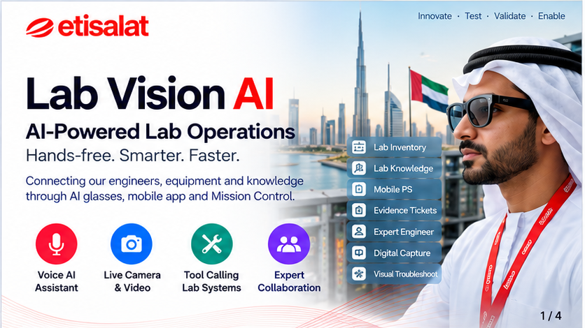
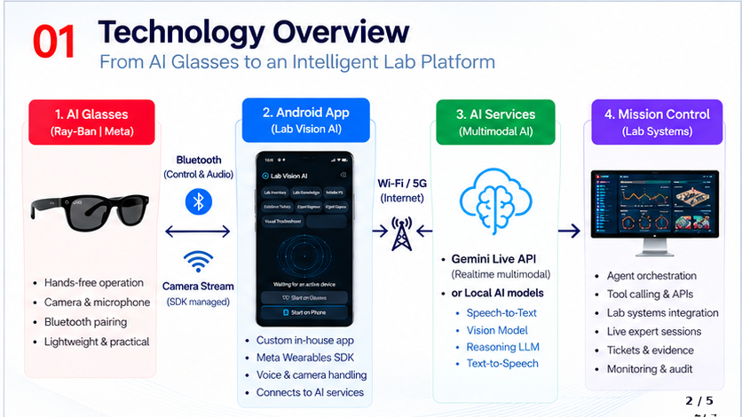
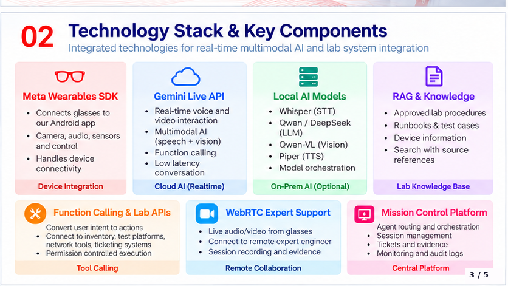

# UAE Lab Vision AI



**TS A&I** · **Innovate · Test · Validate · Enable**

**AI-Powered Lab Operations — Hands-free. Smarter. Faster.**

Connecting our engineers, equipment and knowledge through **AI glasses**, a **mobile app**, and **Mission Control**.

| | |
|---|---|
| **Project** | UAE Lab Vision AI (Mission Control + voice agents) |
| **Organization** | UAELAB |
| **Main development** | [Sultan Sharief Shaik](https://github.com/shaiksultan) (`@shaiksultan`) |
| **Repository** | https://github.com/shaiksultan/VisionClaw |
| **Branch** | [`uae-lab-vision-ai`](https://github.com/shaiksultan/VisionClaw/tree/uae-lab-vision-ai) |
| **Install guide** | [DEMO_INSTALL_AND_USE.md](DEMO_INSTALL_AND_USE.md) |
| **Ready-to-install APKs** | [apks/](apks/) · [Releases](https://github.com/shaiksultan/VisionClaw/releases) |

This repository builds on [VisionClaw](https://github.com/Intent-Lab/VisionClaw) (Meta Ray-Ban + Gemini Live) and extends it into a **telecom lab operations platform** for UAELAB.

---

## Download & install apps (APK)

| App | File | Size | Install |
|-----|------|------|---------|
| **UAE Lab Vision AI** (glasses / phone AI) | [Releases → `UAE-Lab-Vision-AI.apk`](https://github.com/shaiksultan/VisionClaw/releases) | ~156 MB | Sideload on Android (see note below) |
| **UAE Lab Expert** (call receiver) | [`apks/UAE-Lab-Expert.apk`](apks/UAE-Lab-Expert.apk) | ~26 MB | In-repo download |

```powershell
# After downloading APKs to your PC:
adb install -r UAE-Lab-Vision-AI.apk
adb install -r UAE-Lab-Expert.apk
```

> **Note:** GitHub blocks files over 100 MB inside the git tree. The Vision AI APK is published as a **GitHub Release** asset. The Expert APK is included under `apks/`.

On Lab Expert, set Mission Control URL to `http://YOUR_PC_IP:8090`.

---

## About this project

UAE Lab Vision AI turns Meta Ray-Ban glasses and Android phones into a voice-first lab assistant. Field and lab engineers speak naturally; agents call lab systems, create evidence, and can escalate to a live Expert Engineer with glasses video.

### What it delivers

| Capability | Description |
|------------|-------------|
| **Voice AI Assistant** | Real-time multimodal conversation (speech + vision) |
| **Live camera & video** | Glasses / phone camera into Gemini Live and Expert sessions |
| **Tool calling** | Intent → inventory, knowledge, tests, tickets, lab APIs |
| **Expert collaboration** | Live WebRTC call from glasses to Mission Control / Lab Expert app |

### Voice-activated agents (Mission Control)

Say the agent name to launch the corresponding lab service:

| Agent | Example prompt | What it does |
|-------|----------------|--------------|
| **Expert Engineer** | “Open Expert Engineer” | Connect to a remote expert via live video |
| **Lab Inventory** | “Open Lab Inventory” | Find or add equipment; stock & location |
| **Lab Knowledge** | “Open Lab Knowledge” | Approved procedures & runbooks |
| **Evidence Tickets** | “Open Evidence Tickets” | Photo/video evidence + tracked ticket |
| **Digital Capture** | “Open Digital Capture” | Lab environments & digital context |
| **Mobile PS** | “Start Mobile PS…” | Dual-UE packet-core validation |
| **Visual Troubleshoot** | Visual fault assist | Camera-assisted troubleshooting |

### Other voice-activated services

Additional agents demonstrate the flexibility of the UAE Lab Vision AI platform:

| Service | Example | Purpose |
|---------|---------|---------|
| **Live Music** | “Open Live Music” | Voice-driven music discovery and playback |
| **BBC Radio** | “Open BBC Radio” | Radio content via natural voice commands |
| **Live Football** | “Open Live Football” | Football updates / demo audio by voice |

Purpose: show that **new services can be added through the same voice-first agent interface**.

---

## Technology overview



```
Ray-Ban Meta glasses  --Bluetooth / camera SDK-->  UAE Lab Vision AI (Android)
        |                                              |
        | Wi-Fi / 5G                                   |
        v                                              v
   Gemini Live API (realtime multimodal)     optional local AI (STT/LLM/Vision/TTS)
        |
        v
   Mission Control (lab systems)
   · Agent orchestration · Tool calling & APIs
   · Live expert sessions · Tickets & evidence · Monitoring & audit
```

### Technology stack & key components



| Layer | Role |
|-------|------|
| **Meta Wearables SDK** | Glasses ↔ Android: camera, audio, sensors, control |
| **Gemini Live API** | Realtime voice + vision, function calling, low latency |
| **Local AI (optional)** | Whisper STT · Qwen/DeepSeek LLM · Qwen-VL · Piper TTS |
| **RAG & Knowledge** | Approved procedures, runbooks, device info, cited search |
| **Function calling & lab APIs** | Intent → inventory, tests, network tools, ticketing |
| **WebRTC Expert Support** | Live A/V from glasses → expert; session evidence |
| **Mission Control** | Agent routing, sessions, tickets, monitoring |

---

## Repository layout

```text
VisionClaw/
├── DEMO_INSTALL_AND_USE.md     ← step-by-step install & demo script
├── apks/                       ← ready-to-install Expert APK (+ README for Vision AI release)
├── people-directory/           ← Mission Control web + API (:8090)
│   ├── backend/                ← Mobile PS FastAPI (:8100)
│   └── frontend/               ← Mobile PS UI (:5173)
├── samples/
│   ├── CameraAccessAndroid/    ← UAE Lab Vision AI Android sources
│   └── LabExpert/              ← Expert Engineer call-receiver sources
└── assets/                     ← README / deck visuals
```

---

## Quick start

**Full instructions:** [DEMO_INSTALL_AND_USE.md](DEMO_INSTALL_AND_USE.md)

### Clone

```powershell
git clone -b uae-lab-vision-ai https://github.com/shaiksultan/VisionClaw.git
cd VisionClaw
```

### Mission Control (PC)

```powershell
cd people-directory
npm install
npm start
```

Open `http://localhost:8090` (or `http://YOUR_PC_IP:8090` from phones).

### Or install from APKs (no Android Studio)

1. Download **UAE-Lab-Vision-AI.apk** from [Releases](https://github.com/shaiksultan/VisionClaw/releases).  
2. Download **UAE-Lab-Expert.apk** from [`apks/`](apks/).  
3. `adb install -r` both APKs (or open the files on the phone).

---

## Demo flow (short)

1. Start **Mission Control** on the PC.  
2. Open **UAE Lab Vision AI** → Start on Glasses or Phone → **AI ON**.  
3. Try: “Open Lab Inventory”, “Open Lab Knowledge”, “Open Evidence Tickets”, “Open Expert Engineer”.  
4. On a second phone, answer with **UAE Lab Expert**.  
5. End the call → review the open evidence ticket in Mission Control.

---

## Credits & lineage

### Design concept

Concept and design contributors:

| | |
|---|---|
| **Ayman Elnashar** | Design concept |
| **Mohamed S. AlZaabi** | Design concept |
| **Mohammad Sameer** | Design concept |
| **Yunus Shaikh** | Design concept |

### Main development

| | |
|---|---|
| **Sultan Sharief Shaik** ([@shaiksultan](https://github.com/shaiksultan)) | **Main development** — UAE Lab Vision AI app, Mission Control, agents, Expert Engineer, and demo platform |

### Platform lineage

- Built on **VisionClaw** (Meta Ray-Ban + Gemini Live + OpenClaw). Upstream / org mirrors: [Intent-Lab/VisionClaw](https://github.com/Intent-Lab/VisionClaw).  
- Hardware: Meta Ray-Ban smart glasses · Meta Wearables DAT SDK.  
- Cloud AI: [Gemini Live API](https://ai.google.dev/gemini-api/docs/live).

### VisionClaw academic citation (upstream)

```bibtex
@article{liu2026visionclaw,
  title={VisionClaw: Always-On AI Agents through Smart Glasses},
  author={Liu, Xiaoan and Lee, DaeHo and Gonzalez, Eric J and Gonzalez-Franco, Mar and Suzuki, Ryo},
  journal={arXiv preprint arXiv:2604.03486},
  year={2026}
}
```

---

## License

This source code is licensed under the license found in the [LICENSE](LICENSE) file in the root directory of this source tree.

---

*Reference deck: UAE Lab Vision AI (TS A&I). Branch: `uae-lab-vision-ai`.*
